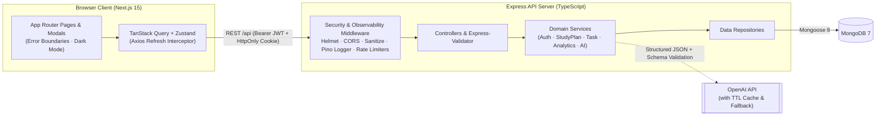

<div align="center">

# 🎯 AI Study Planner

**Enterprise-grade full-stack AI study planning, task management, Pomodoro focus tracking, and productivity analytics platform.**

[](https://github.com/tsunade601/ai-study-planner/actions/workflows/ci.yml)


</div>

## ✨ Key Capabilities

- **AI Curriculum & Task Generation**: Generates structured multi-day study plans and actionable task breakdowns via OpenAI (`response_format: { type: 'json_object' }`), complete with prompt sanitization, strict runtime schema validation, TTL response caching, and deterministic curriculum fallbacks when offline or unconfigured.
- **Layered Clean Architecture**: Strict separation of concerns across `Routes → Controllers → Services → Repositories → Models` in TypeScript.
- **Task & Study Plan Management**: Full CRUD workflows with status transitions (`todo`, `in_progress`, `completed`, `cancelled`), priority filtering, real-time keyword search, overdue detection, and direct hour logging.
- **Pomodoro Focus Engine**: Configurable focus, short-break, and long-break timers with Web Audio alerts, browser notifications, user-preference synchronization, and automatic focus-hour logging to the active study plan.
- **Productivity Analytics**: Interactive Recharts visualizations for 7/30/90-day daily study velocity and per-subject hour distribution.
- **Enterprise Security & Observability**: Short-lived JWT access tokens + rotating SHA-256 hashed refresh tokens (HttpOnly cookies), tiered rate limiters (`authLimiter`, `userLimiter`, `aiLimiter`), recursive NoSQL/prototype-pollution sanitization, Helmet security headers, Pino structured JSON logging with `X-Request-Id` correlation, and Kubernetes-ready `/api/health` and `/api/ready` probes.

## 🧱 Tech Stack

| Layer | Technologies |
| :--- | :--- |
| **Frontend** | Next.js 15 (App Router, Standalone Output), React 18, TypeScript 5, Tailwind CSS, TanStack Query v5, Zustand, React Hook Form, Recharts, Framer Motion, Lucide Icons |
| **Backend** | Node.js 20, Express 4, TypeScript 5, Mongoose 8, OpenAI SDK v4, Express Validator, Express Rate Limit, Helmet, Pino & Pino-HTTP, Swagger / OpenAPI 3.0 |
| **Database** | MongoDB 7 (with compound indexes on user, status, subject, and due dates) |
| **Quality & Ops** | Jest, Supertest, ESLint, Prettier, Docker multi-stage builds, Docker Compose, GitHub Actions CI |

## 🏗️ System Architecture



See [`docs/ARCHITECTURE.md`](docs/ARCHITECTURE.md) for a deep dive into the layered backend architecture, authentication token rotation lifecycle, AI resilience pipeline, and data models.

## 📁 Repository Layout

```text
ai-study-planner/
├── backend/                     # Express + TypeScript API workspace
│   ├── src/
│   │   ├── app.ts               # Express app, middleware pipeline, Swagger & health probes
│   │   ├── config/              # Environment variable validation & MongoDB connection
│   │   ├── controllers/         # HTTP request/response handlers
│   │   ├── middleware/          # JWT auth, tiered rate limiters, sanitizer, error handler, logger
│   │   ├── models/              # Mongoose schemas & lifecycle hooks (User, StudyPlan, Task)
│   │   ├── repositories/        # Data-access layer isolating Mongoose queries & aggregations
│   │   ├── routes/              # Express route definitions with OpenAPI JSDoc annotations
│   │   ├── services/            # Business logic & AI integration with fallback/caching
│   │   ├── types/               # Shared TypeScript interfaces & API contracts
│   │   └── utils/               # AppError, JWT helpers, Pino logger, response envelopes
│   ├── tests/                   # Jest + Supertest unit & integration test suites
│   ├── server.ts                # HTTP server entrypoint & graceful shutdown handler
│   └── Dockerfile               # Multi-stage non-root production container
├── frontend/                    # Next.js 15 App Router workspace
│   ├── src/
│   │   ├── app/                 # App Router pages, layouts, loading skeletons & error boundaries
│   │   ├── components/          # Dashboard, Pomodoro, layout shell & reusable UI primitives
│   │   ├── hooks/               # TanStack Query hooks (useStudyPlans, useTasks, useAnalytics)
│   │   ├── lib/                 # Axios client with automatic 401 refresh-token rotation
│   │   ├── store/               # Persisted Zustand authentication store
│   │   └── types/               # Frontend TypeScript interfaces
│   └── Dockerfile               # Multi-stage Next.js standalone production container
├── docs/                        # Architecture & production deployment guides
├── docker-compose.yml           # Full-stack orchestration (MongoDB 7 + Backend + Frontend)
├── .github/workflows/ci.yml     # Automated lint, type-check, test, and Docker build pipeline
└── package.json                 # Root npm workspaces configuration
```

## 🚀 Quick Start

### Option A: Docker Compose (Recommended)

```bash
cp .env.example .env
# Set a strong JWT_SECRET (32+ characters) and optional OPENAI_API_KEY in .env
docker compose up --build
```

- **Frontend Web App**: `http://localhost:3000`
- **Backend API Base**: `http://localhost:5000/api`
- **Interactive Swagger Docs**: `http://localhost:5000/api/docs`
- **Liveness / Readiness Probes**: `http://localhost:5000/api/health` · `http://localhost:5000/api/ready`

### Option B: Local Workspace Development

```bash
# 1. Install dependencies across both workspaces from repo root
npm install

# 2. Configure environment files
cp backend/.env.example backend/.env
cp frontend/.env.example frontend/.env.local

# 3. Start backend and frontend concurrently
npm run dev:all
```

## ⚙️ Environment Variables

### Backend (`backend/.env`)

| Variable | Required | Default | Description |
| :--- | :--- | :--- | :--- |
| `PORT` | No | `5000` | HTTP server listening port |
| `NODE_ENV` | No | `development` | Runtime environment (`development` \| `test` \| `production`) |
| `LOG_LEVEL` | No | `debug` / `info` | Pino log level (`trace` \| `debug` \| `info` \| `warn` \| `error` \| `fatal` \| `silent`) |
| `MONGODB_URI` | **Yes** | — | MongoDB connection URI |
| `JWT_SECRET` | **Yes** | — | Secret key for signing JWTs (minimum 32 characters recommended in production) |
| `JWT_EXPIRES_IN` | No | `15m` | Access token expiration window |
| `JWT_REFRESH_EXPIRES_IN` | No | `30d` | Refresh token expiration window |
| `OPENAI_API_KEY` | No | — | OpenAI API key (falls back to deterministic study plans & tasks when omitted) |
| `OPENAI_MODEL` | No | `gpt-4o-mini` | OpenAI chat completion model identifier |
| `OPENAI_TIMEOUT_MS` | No | `15000` | Timeout in milliseconds for outbound OpenAI API requests |
| `CLIENT_URL` | No | `http://localhost:3000` | Allowed CORS origin for browser requests |

### Frontend (`frontend/.env.local`)

| Variable | Required | Default | Description |
| :--- | :--- | :--- | :--- |
| `NEXT_PUBLIC_API_URL` | No | `http://localhost:5000/api` | Backend REST API base URL |
| `NEXT_PUBLIC_APP_URL` | No | `http://localhost:3000` | Public frontend application URL |

## 📡 API Endpoints Overview

Interactive OpenAPI 3.0 documentation is served at `GET /api/docs`.

| Domain | Method & Path | Auth | Rate Limiter | Description |
| :--- | :--- | :--- | :--- | :--- |
| **Ops** | `GET /api/health` | Public | Exempt | Process liveness probe (`{ status, uptime, timestamp }`) |
| **Ops** | `GET /api/ready` | Public | Exempt | Readiness probe verifying MongoDB connection (`200` / `503`) |
| **Auth** | `POST /api/auth/register` | Public | `authLimiter` | Register user, issue access token & HttpOnly refresh cookie |
| **Auth** | `POST /api/auth/login` | Public | `authLimiter` | Authenticate user and rotate refresh token cookie |
| **Auth** | `POST /api/auth/refresh` | Cookie | `authLimiter` | Verify & rotate refresh token, issue new access token |
| **Auth** | `POST /api/auth/logout` | Cookie | `global` | Revoke stored refresh token hash and clear cookie |
| **Auth** | `GET /api/auth/me` | Bearer | `global` | Retrieve current authenticated user profile |
| **Auth** | `PATCH /api/auth/me` | Bearer | `global` | Update user profile and study/Pomodoro preferences |
| **Plans** | `GET /api/study-plans` | Bearer | `userLimiter` | List study plans (`?status=`, `?priority=`, `?subject=`, `?search=`) |
| **Plans** | `POST /api/study-plans` | Bearer | `userLimiter` | Create a new study plan |
| **Plans** | `GET /api/study-plans/:id` | Bearer | `userLimiter` | Retrieve a single study plan by ID |
| **Plans** | `PATCH /api/study-plans/:id` | Bearer | `userLimiter` | Update study plan details or status |
| **Plans** | `DELETE /api/study-plans/:id` | Bearer | `userLimiter` | Delete a study plan |
| **Plans** | `POST /api/study-plans/:id/log-hours` | Bearer | `userLimiter` | Log completed study hours (auto-completes when target reached) |
| **Plans (AI)** | `POST /api/study-plans/ai/suggest` | Bearer | `aiLimiter` | Generate structured AI study plan curriculum |
| **Tasks** | `GET /api/tasks` | Bearer | `userLimiter` | List tasks (`?status=`, `?priority=`, `?studyPlan=`, `?dueDate=`, `?search=`) |
| **Tasks** | `POST /api/tasks` | Bearer | `userLimiter` | Create a new study task |
| **Tasks** | `GET /api/tasks/:id` | Bearer | `userLimiter` | Retrieve a single task by ID |
| **Tasks** | `PATCH /api/tasks/:id` | Bearer | `userLimiter` | Update task fields or status (auto-maintains `completedAt`) |
| **Tasks** | `DELETE /api/tasks/:id` | Bearer | `userLimiter` | Delete a task |
| **Tasks (AI)** | `POST /api/tasks/ai/suggest` | Bearer | `aiLimiter` | Generate 5–10 AI-suggested study tasks for a topic |
| **Analytics** | `GET /api/analytics/summary` | Bearer | `userLimiter` | Aggregate task and study plan statistics by status |
| **Analytics** | `GET /api/analytics/daily?days=30` | Bearer | `userLimiter` | Daily completed tasks and study minutes (`1`–`365` days) |
| **Analytics** | `GET /api/analytics/subjects` | Bearer | `userLimiter` | Per-subject target vs. completed hours breakdown |

## 🧪 Testing & Quality Assurance

Run all workspace quality gates from the repository root or per package:

```bash
# Run lint, type-check, and test suites across all workspaces
npm run check:all

# Backend workspace commands
cd backend
npm run lint           # ESLint static analysis
npm run type-check     # TypeScript compiler check (tsc --noEmit)
npm run format:check   # Prettier formatting verification
npm test               # Jest + Supertest unit & integration tests with coverage

# Frontend workspace commands
cd ../frontend
npm run lint           # Next.js Core Web Vitals ESLint check
npm run type-check     # TypeScript strict type verification
npm run format:check   # Prettier formatting verification
npm run build          # Production Next.js standalone build
```

## 📦 Deployment & Contributing

- **Deployment Guide**: See [`docs/DEPLOYMENT.md`](docs/DEPLOYMENT.md) for Docker, reverse-proxy, and cloud PaaS deployment instructions.
- **Contributing Guide**: See [`CONTRIBUTING.md`](CONTRIBUTING.md) for coding conventions, architectural layers, and pull request requirements.
- **License**: Released under the [MIT License](LICENSE).
