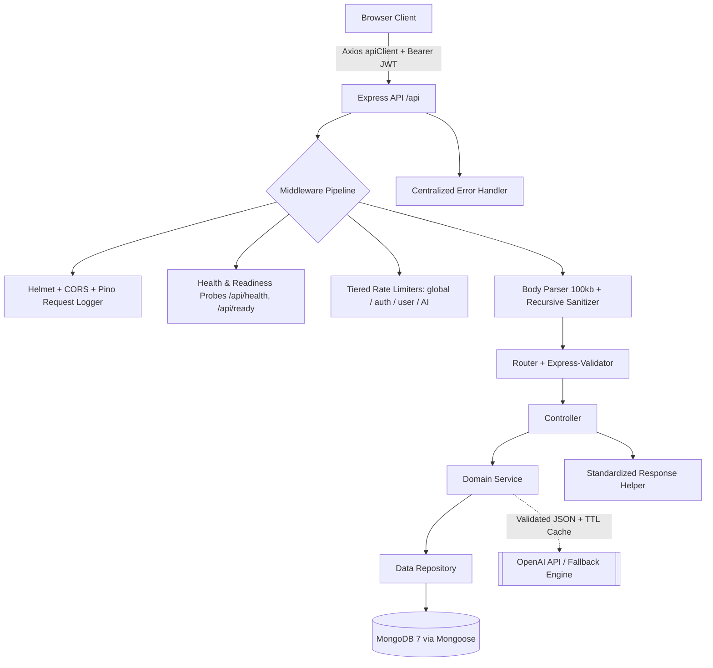

# System Architecture

This document details the internal architecture, request lifecycle, AI integration design, security controls, and data models of the **AI Study Planner** platform.

## 1. High-Level Overview

The platform is organized as a TypeScript monorepo with two primary application workspaces:

- **Frontend (`frontend/`)**: Next.js 15 App Router application utilizing Server Components for layout shells and Client Components (`'use client'`) for interactive study planning, task management, Pomodoro focus tracking, and Recharts analytics. Server state is managed via **TanStack Query v5**, and authentication state is managed via **Zustand**.
- **Backend (`backend/`)**: Node.js 20 & Express 4 REST API written in strict **TypeScript**, structured around a clean **Route → Controller → Service → Repository → Model** architecture. Interactive OpenAPI 3.0 documentation is served at `/api/docs`.
- **Database**: **MongoDB 7** accessed through Mongoose 8 schemas with compound indexing and virtual properties.
- **AI Engine (`backend/src/services/aiService.ts`)**: Resilient OpenAI integration featuring prompt-injection sanitization, dynamic token budgeting, strict runtime JSON output validation, in-memory TTL caching, and deterministic curriculum fallbacks.

## 2. Backend Request Lifecycle & Layer Separation

1. **Security & Correlation (`helmet`, `cors`, `requestLogger`)**:
   - `helmet` configures HTTP security headers.
   - `cors` restricts cross-origin requests to `CLIENT_URL` and enables credentials for HttpOnly refresh cookies.
   - `requestLogger` (`pino-http`) assigns or propagates an `X-Request-Id` header and attaches a child logger to `req.log`.
2. **Health Probes (`/api/health`, `/api/ready`)**:
   - Mounted prior to rate limiting so container orchestrators (Docker, Kubernetes, Render, Fly.io) can probe liveness and MongoDB readiness without consuming rate-limit quotas.
3. **Tiered Rate Limiting (`middleware/rateLimiters.ts`)**:
   - **Global Limiter**: 150 requests / 15 minutes per IP across `/api/*`.
   - **`authLimiter`**: 20 requests / 15 minutes per IP on `/api/auth/register`, `/api/auth/login`, and `/api/auth/refresh`.
   - **`userLimiter`**: 150 requests / 15 minutes keyed by authenticated `user._id` (or IP fallback).
   - **`aiLimiter`**: 15 requests / 15 minutes per user/IP on `/api/study-plans/ai/suggest` and `/api/tasks/ai/suggest` to protect LLM token budgets.
4. **Payload Parsing & Sanitization (`middleware/sanitizeMiddleware.ts`)**:
   - JSON bodies are capped at `100kb`.
   - `sanitizeRequest` recursively strips MongoDB operator keys (`$`, `.`), prototype-pollution vectors (`__proto__`, `constructor`, `prototype`), and null bytes (`\0`) from `req.body`, `req.query`, and `req.params`.
5. **Routes & Validation (`routes/*.ts`)**:
   - Each endpoint declares `express-validator` chains verifying field presence, string bounds, numeric ranges, enum membership, and chronological date ordering (`endDate >= startDate`).
6. **Controllers (`controllers/*.ts`)**:
   - Extract validated inputs from `req`, delegate execution to the corresponding service, and format HTTP responses via `utils/responseHelper.ts`.
7. **Services (`services/*.ts`)**:
   - Enforce domain invariants (e.g., auto-transitioning a `StudyPlan` to `completed` when `completedHours >= targetHours`, and automatically stamping or clearing `Task.completedAt` when task status changes).
8. **Repositories (`repositories/*.ts`)**:
   - Isolate Mongoose queries (`User`, `StudyPlan`, `Task`) and MongoDB `$match` / `$group` aggregation pipelines from service logic.
9. **Centralized Error Handling (`middleware/errorHandler.ts`)**:
   - Normalizes operational `AppError` instances, Mongoose `ValidationError`, `CastError`, duplicate key (`11000`), malformed JSON `SyntaxError`, and JWT errors into a consistent `{ success: false, message, code, requestId, errors }` envelope while masking internal `500` details in production.

## 3. Authentication & Token Rotation Flow

- **Issuance**: Upon registration or login, the server signs a short-lived **Access Token** (`JWT_EXPIRES_IN`, default `15m`, `type: 'access'`) returned in the JSON body and a long-lived **Refresh Token** (`JWT_REFRESH_EXPIRES_IN`, default `30d`, `type: 'refresh'`, unique `jti`) set in an `HttpOnly`, `SameSite=Lax` cookie scoped to `/api/auth`.
- **Database Verification**: Only the **SHA-256 hash** of the refresh token is stored on the `User` document (`user.refreshToken`).
- **Silent Rotation**: When the frontend `apiClient` receives a `401 Unauthorized` response, its Axios response interceptor deduplicates concurrent refresh calls via a shared `refreshPromise`, posts to `/api/auth/refresh`, receives a rotated access token + refresh cookie, updates the Zustand store, and transparently retries the original request.

## 4. AI Integration Architecture (`services/aiService.ts`)

1. **Input Sanitization & Prompt Hardening**:
   - `sanitizePromptInput` strips control characters, normalizes whitespace, and enforces strict character caps (`subject` ≤ 120 chars, `goals` ≤ 250 chars, `description` ≤ 300 chars).
   - Numeric parameters are clamped (`daysAvailable` ∈ `[1, 60]`, `hoursPerDay` ∈ `[0.5, 16]`) to prevent unbounded array allocations or token truncation.
2. **Token Budget Optimization & TTL Caching**:
   - Token limits (`max_tokens`) scale dynamically with `daysAvailable` (`Math.min(1600, Math.max(800, safeDays * 55))`).
   - An in-memory LRU/TTL cache (`CACHE_TTL_MS = 10m`, max 100 entries) deduplicates repeated requests for identical parameters.
3. **Structured JSON Output Validation**:
   - OpenAI is invoked with `response_format: { type: 'json_object' }`, a 15-second timeout, and automatic retry on transient network/rate-limit errors.
   - `validateStudyPlanOutput` inspects every nested `dailyPlan` entry (`day`, `focus`, `tasks`) and string array (`resources`, `milestones`, `tips`), repairing malformed fields before returning to the caller.
4. **Deterministic Fallback Engine**:
   - When `OPENAI_API_KEY` is unset or the upstream API is unreachable, `fallbackPlan` and `suggestTasks` synthesize level-appropriate (`beginner`, `intermediate`, `advanced`) multi-phase study roadmaps and task lists so the user experience never degrades.
